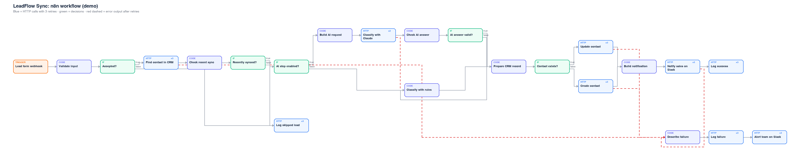
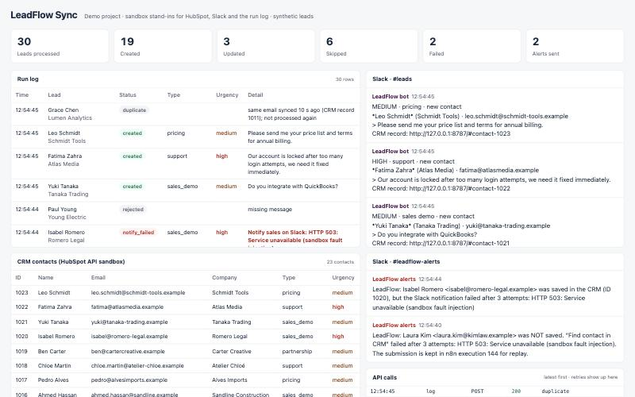

# LeadFlow Sync

**Demo project.** An n8n workflow that takes website form leads, validates and de-duplicates them, classifies them (Claude or keyword rules), creates or updates the contact in HubSpot, tells the sales team in Slack and writes every run to a log, with retries and alerts when a step keeps failing.

Everything here runs locally against a **sandbox** that imitates the HubSpot CRM v3 API, Slack incoming webhooks and the log endpoint, so the demo needs no third-party accounts. All leads are synthetic (`.example` domains, invented people and companies). This is a personal portfolio project, not client work.



## What it does

1. **Validate**: normalises name and email, rejects invalid emails, empty messages and spam (hidden honeypot field, link-stuffed messages).
2. **De-duplicate, using the CRM as the source of truth**: looks the email up in HubSpot first. If the contact was synced less than 10 minutes ago, the submission is a re-send and is skipped *before* any AI call or CRM write. Stateless, so it survives restarts and works with several n8n instances.
3. **Classify**: lead type (sales demo, pricing, support, partnership, job application, other), urgency and a one-line summary.
   - With `LEADFLOW_AI=on`: Claude via the Messages API, constrained by a strict JSON schema, with server-side fallback if the request is declined. The answer is validated before use; the form text is passed as data, never as instructions.
   - If the AI step is off, the call fails after its retries, or the answer is invalid: keyword rules take over, and the log records which classifier ran and why.
4. **Create or update the contact** in HubSpot (search → PATCH or POST), including custom `leadflow_*` properties.
5. **Notify** the sales channel in Slack with urgency, type, summary and a link to the CRM record.
6. **Log** every lead (created, updated, duplicate, rejected, failed, notify_failed) with the reason.
7. **Resilience**: every HTTP step retries 3 times, 1 s apart. A CRM or Slack failure that survives the retries is logged with the failing step and posted to `#leadflow-alerts`; the submission stays in the n8n execution for replay.



## Results of the demo run

`python scripts/run_demo.py` sends 30 synthetic leads through the running workflow, injects faults through the sandbox and checks every outcome (report in `output/run_report.md`):

| Check | Result |
|---|---|
| Every lead produced exactly one log row | 30 / 30 |
| Final status matches the expected outcome | 30 / 30 (19 created, 3 updated, 2 duplicates, 4 rejected, 1 failed, 1 notify_failed) |
| CRM outage (3 × HTTP 503) on lead 21 | retried 3 times, logged as `failed`, alert posted |
| Transient CRM error (1 × 503) on lead 22 | recovered on retry, contact created |
| Slack outage (3 × 503) on lead 25 | contact saved, logged as `notify_failed`, alert posted |
| CRM ends with seeded contacts + new leads, no duplicate contacts | 23 contacts |
| One Slack message per synced lead | 22 |
| Time for 30 leads, sent one after another | ~14 s |

Three consecutive runs gave the same result.

**What these results do and don't show:**
- They prove the workflow logic, retries, error routing and logging end to end against API stand-ins. They are not a test against live HubSpot, Slack or Google Sheets accounts.
- Classification in the demo run is done by the keyword rules, which I wrote against this same data set: 23 / 23 matches is a consistency check, not a benchmark.
- The Claude step is covered by unit tests on the request it builds and on how it handles valid, refused, truncated and malformed answers. Live, I only verified the fallback: with the AI step on and no valid API key, the call fails, is retried, and the lead is classified by rules (logged as `rules (AI call failed)`). Claude's classification accuracy has not been measured yet.

## Run it

Requires Node.js 24+, Python 3.10+ and about 4 GB of disk for the local n8n install.

```bash
cd runtime && npm install && cd ..       # installs n8n 2.43.5 locally (large)
python3 scripts/setup.py                 # creates .env, imports credentials + workflow, publishes it
python3 sandbox/server.py                # terminal 1: sandbox + dashboard on http://127.0.0.1:8787
python3 scripts/start_n8n.py             # terminal 2: n8n on http://localhost:5678
python3 scripts/run_demo.py --delay 1    # terminal 3: 30 leads, checks, report
```

Open http://127.0.0.1:8787 to watch the run log, CRM contacts, Slack channels and API calls (retries included) update live. To see the workflow in the n8n editor, open http://localhost:5678 and create the local owner account n8n asks for on first visit.

Tests (no n8n needed):

```bash
node --test tests/                       # 20 tests: the JavaScript of every Code node, run unchanged
python3 -m unittest discover tests       # sandbox follows the HubSpot / Slack contracts
```

## Connecting real services

Edit `.env`, then rerun `scripts/setup.py` with n8n stopped:

| Setting | Real value |
|---|---|
| `CRM_BASE_URL`, `HUBSPOT_TOKEN` | `https://api.hubapi.com` and a HubSpot private app token (contacts read/write). Run `scripts/hubspot_properties.py` once to create the `leadflow_*` properties. |
| `CRM_RECORD_URL` | `https://app.hubspot.com/contacts/<portalId>/record/0-1/{id}` |
| `SLACK_LEADS_WEBHOOK_URL`, `SLACK_ALERTS_WEBHOOK_URL` | Slack incoming webhook URLs for the two channels |
| `LOG_URL` | URL of `sheets/apps_script.gs` deployed as a Google Apps Script web app (appends rows to a sheet) |
| `LEADFLOW_AI`, `ANTHROPIC_API_KEY`, `LEADFLOW_MODEL` | `on`, your API key, model (default `claude-opus-5-5`; a cheaper model is a reasonable choice for high volumes) |

These adapters follow the public API contracts, but I have not run them against live accounts. Expect a short verification pass when connecting a real HubSpot portal or Google Sheet.

**Secrets:** tokens are imported into n8n's encrypted credential store and are kept out of the n8n process environment and out of the workflow file. `.env` is git-ignored.

## Project layout

```
workflow/
  build_workflow.py     assembles the n8n workflow JSON (nodes, retries, error outputs, layout)
  code/*.js             JavaScript of each Code node, readable and unit-tested
  leadflow-sync.json    generated workflow, importable into any n8n
sandbox/
  server.py             HubSpot CRM v3 subset, Slack webhooks, log endpoint, fault injection
  dashboard.html        live view of the run
scripts/
  setup.py              import credentials + workflow into the local n8n and publish
  start_n8n.py          start n8n with the config (secrets excluded from its environment)
  run_demo.py           30-lead scenario with injected faults and automatic checks
  hubspot_properties.py create the custom contact properties in a real HubSpot portal
sheets/apps_script.gs   Google Sheets log endpoint (same contract as the sandbox)
data/leads.json         synthetic leads with expected outcomes
tests/                  Code node tests (node:test) and sandbox contract tests (unittest)
docs/                   diagram, dashboard screenshot, diagram renderer
```

## Notes

- n8n applies publications made from the CLI asynchronously after it starts. `run_demo.py` waits until the newly published version is live before sending leads, so a run is never split across two versions.
- The workflow's static data is deliberately not used for de-duplication: overlapping executions overwrite each other's static data. The CRM lookup is the reliable source.
